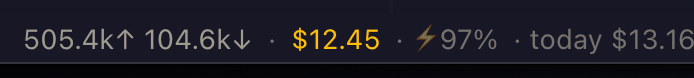
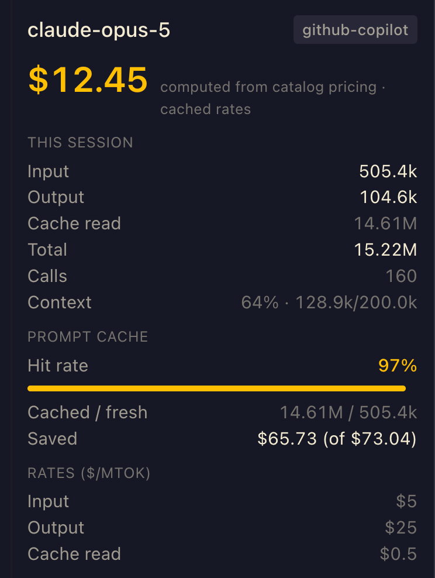

# Token & Cost Meter

**English** · [简体中文](README.zh-CN.md)

A Hermes Desktop plugin that shows, live in the status bar, how many tokens the
focused session has burned, what that costs in USD, and how much the prompt
cache is saving you. Everything it observes is folded into a local per-day
ledger, so the numbers are still there after you restart Hermes.



Click the chip for the full ledger: today / 7 days / this month / all time,
broken down per model, with cache hit rate and savings per row.

## Why it exists

Hermes' gateway reports live token counters, but the cost side has two gaps:

- **Only 7 providers report pricing.** `hermes_cli/models_pricing.py` fetches
  live rates for `openrouter`, `nous`, `ai-gateway`, `novita`, `deepinfra`,
  `fireworks` and `kilocode`. Everything else — notably subscription/OAuth
  routes like **GitHub Copilot** — returns an empty `pricing` block, so a naive
  reader just shows "pricing unavailable".
- **The counters reset.** They live in the agent process, so quitting Hermes
  zeroes them. Nothing backfills them from the database on restart.

This plugin closes both: a bundled rate table from [models.dev](https://models.dev)
covers the providers Hermes doesn't price, and a `ctx.storage` ledger keeps the
history.

## Install

### From this repository

```bash
hermes plugins install IT-dreamer/token-cost-meter
```

Hermes will note that this is a custom, unreviewed source — it is not (yet) in
the official plugin catalog. To pin an exact commit rather than tracking the
default branch:

```bash
hermes plugins install IT-dreamer/token-cost-meter --ref <40-char-commit-sha>
```

### Manually

Copy `desktop/plugin.js` into your desktop plugin directory:

```bash
mkdir -p ~/.hermes/desktop-plugins/token-cost-meter
cp desktop/plugin.js ~/.hermes/desktop-plugins/token-cost-meter/
```

Then in the Hermes desktop app: **⌘K → Reload desktop plugins**.

No entry in `config.yaml` is needed — this is a pure front-end plugin.

## What you get

**Status bar chip** — input/output tokens, session cost, cache hit rate, and
today's running total. Hover for details.

**Right-hand pane** — this session's token breakdown, the rates being applied,
and a prompt-cache section (hit rate, cached vs fresh, dollars saved). Range
totals live on the ledger page. Totals are kept per conversation, so reopening a
conversation after quitting Hermes shows what it has cost so far (conversations
from before v2.0 start counting from their next reply).



**Ledger page** — a sortable per-model table across four time ranges, with a
grand total, aggregate cache hit rate and total savings.

Bilingual: English and 简体中文, following the app's language setting.

## How the cost is computed

Rates are resolved in this order, and the pane always tells you which one it
used:

| # | Source | Shown as |
|---|--------|----------|
| 1 | The active provider's live catalog pricing | `computed from catalog pricing` |
| 2 | Rates remembered from an earlier live hit | `cached rates` |
| 3 | The bundled models.dev table | `estimated from models.dev rates` |
| 4 | Another provider's rates for the same model id | ⚠ `rates borrowed from <slug>` |

Step 4 is a deliberate last resort with a visible warning. Several providers
list the same model id at different prices (Nous and GitHub Copilot both carry
`claude-opus-5`, at $4/$20 and $5/$25 per Mtok respectively), so borrowed rates
are never passed off as your own route's.

If the gateway itself reports a `cost_usd`, that always wins — it is the only
figure that isn't an estimate.

### Token streams

Hermes' `CanonicalUsage` defines `prompt = input + cache_read + cache_write`, so
each stream is billed at its own rate rather than counted twice:

- `input` and `cache_write` → the input rate
- `cache_read` → the cache rate (falling back to input when a model has none)
- `output` → the output rate

### Cache savings

Savings is what the cached tokens *would* have cost at the full input rate,
minus what they actually cost at the cache rate. Cache writes bill at the input
rate either way, so they're neutral and excluded.

The gateway only sends a rounded `cache_hit_pct` (present only when cache reads
> 0), not raw cache token counts. The split is recovered as:

- raw `cache_read` / `cache_write` sent → exact
- `prompt > input`, no hit% → the whole gap is cache **writes** (exact)
- `prompt > input`, hit% present → reads ≈ `prompt × hit%` capped at the gap,
  the rest are writes (estimated)
- `prompt == input`, hit% present → input is split by hit% (estimated)

Estimated figures are shown with a `≈` prefix and a note; savings derived from
them are estimates too.

## The ledger

Gateway counters are cumulative per live agent and reset on restart, `/new` and
`/reset`. The ledger diffs each reading against a per-`session::model` snapshot
and accumulates only the delta; a counter that moves backwards is read as a
fresh run and adopted whole. Totals are kept per calendar day (local time, not
UTC) for 400 calendar days, bucketed by **profile + provider + model** — the same
model on two routes is two rows.

**Costs are settled when recorded.** Each delta is priced at that moment with the
serving provider's rates (resolved with `model.options { session_id }`, so split
tiles never borrow another session's provider) and the dollars are stored with
their rate source (`gateway` / `live` / `remembered` / `bundled` / `foreign`).
A later catalog change never rewrites history. Tokens with no known rate are
counted separately and the total is shown as `≥`.

Ledgers from 1.x (`ledger.v1`, tokens only) are migrated to `ledger.v2` on first
load; the old key is left untouched as a backup. Those rows are labelled
"pre-2.0" and are still estimated at current rates, since no price was stored.

The full page exports the ledger as CSV (one row per day × bucket, with the cost
basis) or copies it as JSON. A failed storage write raises a warning instead of
being silently dropped.

Intake comes from `message.complete` and `session.usage` events, with a 30s
sweep of the focused session as a safety net.

Two honest limitations:

- **No backfill.** Only usage seen while the plugin was running is recorded.
  Sessions from before you installed it aren't in the ledger.
- **Desktop only.** Usage from the CLI/TUI doesn't reach this ledger.

Data lives in the plugin's own `ctx.storage` namespace. Nothing is sent
anywhere.

## Refreshing the rate table

The bundled rates are a snapshot taken when the pinned commit was cut. To
regenerate them from the models.dev catalog Hermes already keeps on disk:

```bash
python3 scripts/gen-rates.py
```

This rewrites the `FALLBACK_RATES` literal in `desktop/plugin.js` in place.
(The desktop plugin loader rejects relative imports, so the table can't live in
its own module.) Currently ships ~1130 models across 21 providers.

## Accuracy

These are **estimates**, not billing data. Catalog `$/Mtok` rates are list
prices; subscription routes bill a flat monthly fee regardless of what this
shows. Read a Copilot figure as "what this would have cost at API list price".

## License

Apache-2.0
