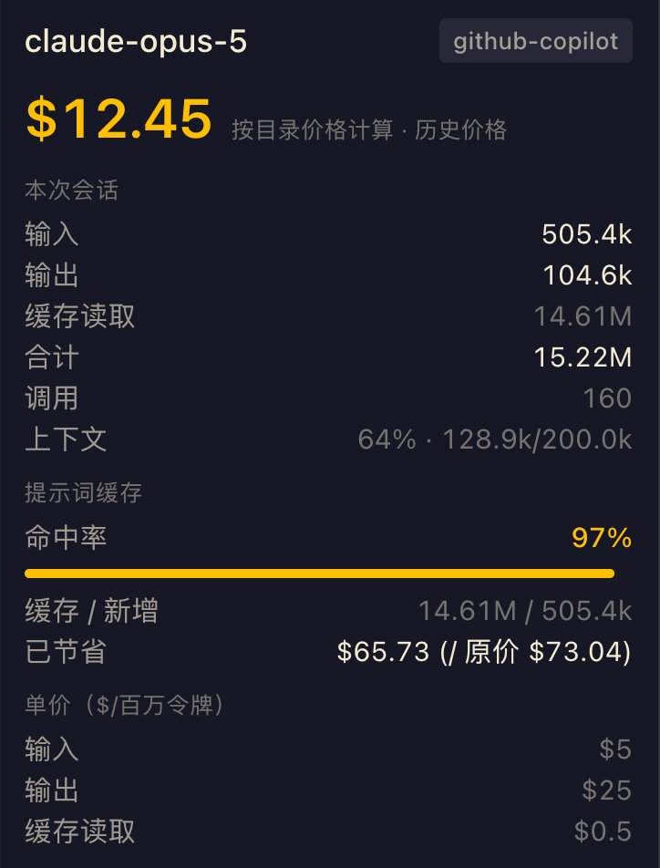

# Token & Cost Meter

[English](README.md) · **简体中文**

一个 Hermes 桌面端插件：在状态栏实时显示当前会话烧掉了多少 token、折算成多少美元、
以及提示词缓存帮你省了多少钱。所有观察到的用量都会折叠进本地的按日账本，
**重启 Hermes 之后数字依然在**。


点击芯片进入完整账本：今日 / 近 7 天 / 本月 / 全部，按模型拆分，每行带缓存命中率和节省额。

## 为什么需要它

Hermes 网关本身会上报实时 token 计数，但费用这一侧有两个缺口：

- **只有 7 家供应商会上报价格。** `hermes_cli/models_pricing.py` 只为
  `openrouter`、`nous`、`ai-gateway`、`novita`、`deepinfra`、`fireworks`、
  `kilocode` 拉取实时单价。其余的——尤其是 **GitHub Copilot** 这类订阅制 / OAuth
  线路——返回的 `pricing` 是空的，所以直接读取只会显示"价格不可用"。
- **计数器会归零。** 它们存在 agent 进程内存里，退出 Hermes 就清空，
  重启后也没有任何地方从数据库回填。

这个插件把两个缺口都补上：内置一份来自 [models.dev](https://models.dev) 的价格表，
覆盖 Hermes 不计价的那些供应商；再用 `ctx.storage` 账本留住历史。

## 安装

### 从本仓库安装

```bash
hermes plugins install IT-dreamer/token-cost-meter
```

Hermes 会提示这是未经审核的自定义来源——它目前还没有进入官方插件目录。
如果想钉死某个提交而不是跟随默认分支：

```bash
hermes plugins install IT-dreamer/token-cost-meter --ref <40位提交SHA>
```

### 手动安装

把 `desktop/plugin.js` 拷进桌面插件目录：

```bash
mkdir -p ~/.hermes/desktop-plugins/token-cost-meter
cp desktop/plugin.js ~/.hermes/desktop-plugins/token-cost-meter/
```

然后在 Hermes 桌面应用里：**⌘K → Reload desktop plugins**。

不需要在 `config.yaml` 里做任何配置——这是一个纯前端插件。

## 功能

**状态栏芯片** —— 输入/输出 token、本次会话花费、缓存命中率，以及今日累计。悬停查看详情。

**右侧面板** —— 本次会话的 token 明细、当前适用的单价、提示词缓存区块
（命中率、缓存 vs 新增、节省金额）。按时间区间的汇总统一放在账本整页。
用量按会话持久累计：退出 Hermes 后重新打开某个会话，仍能看到它此前的花费和命中率
（v1.0.0 之前的会话从下一次回复开始累计）。



**账本整页** —— 四个时间区间的按模型表格，带总计、整体缓存命中率和累计节省额。

双语：English 与简体中文，跟随应用的语言设置自动切换。

## 费用是怎么算的

单价按以下顺序解析，面板上始终会标明用的是哪一级：

| # | 来源 | 显示为 |
|---|------|--------|
| 1 | 当前供应商的实时目录价 | `按目录价格计算` |
| 2 | 此前实时命中并记住的单价 | `历史价格` |
| 3 | 内置的 models.dev 价格表 | `按 models.dev 单价估算` |
| 4 | 其他供应商同名模型的价格 | ⚠ `借用了 <slug> 的价格` |

第 4 级是刻意保留的兜底，并且**带醒目警告**。多家供应商会列同一个模型 id 但价格不同
（Nous 和 GitHub Copilot 都有 `claude-opus-5`，分别是 $4/$20 和 $5/$25 每百万 token），
所以借来的价格绝不会被冒充成你自己线路的价格。

如果网关自己上报了 `cost_usd`，那个数字永远优先——它是唯一不是估算的值。

### Token 分流计费

Hermes 的 `CanonicalUsage` 定义了 `prompt = input + cache_read + cache_write`，
因此每条流按各自的单价计费，避免重复计数：

- `input` 和 `cache_write` → 按输入价
- `cache_read` → 按缓存价（模型没有缓存价时回落到输入价）
- `output` → 按输出价

### 缓存节省

节省额 = 这些缓存 token 按**完整输入价**本该花的钱，减去按**缓存价**实际花的钱。
缓存写入两种算法下都按输入价计费，属于中性项，因此排除在外。

网关只下发四舍五入后的 `cache_hit_pct`（且仅在有缓存读取时出现），不发原始缓存 token 数，拆分规则：

- 有原始 `cache_read` / `cache_write` → 精确
- `prompt > input` 且无命中率 → 差额全部是缓存**写入**（精确）
- `prompt > input` 且有命中率 → 读取 ≈ `prompt × 命中率`（不超过差额），其余为写入（估算）
- `prompt == input` 且有命中率 → 按命中率拆分 input（估算）

估算值带 `≈` 前缀并附说明，由此得出的节省额同样是估算。

## 关于账本

网关计数器是按活跃 agent 累计的，重启、`/new`、`/reset` 都会归零。
账本的做法是：对每个 `session::model` 存一份快照，只累加**增量**；
读数变小则判定为新的一轮运行，整体采纳。总计按**本地日历日**（不是 UTC）保存 400 天，
并按 **profile + 供应商 + 模型** 分桶——同一模型走两条线路会显示为两行。

**金额在记录时结算。** 每笔增量在记录那一刻，按实际承载线路的单价计价（通过
`model.options { session_id }` 获取，分屏时不会借用别的会话的供应商），并连同价格来源
（`gateway` / `live` / `remembered` / `bundled` / `foreign`）一起存下。之后目录调价不会改写历史。
没有可用单价的 token 单独计数，总额显示为 `≥`。

1.x 的账本（`ledger.v1`，只有 token）首次加载时迁移到 `ledger.v2`，旧键原样保留作备份。
这部分数据当时没有存价格，会标注为「1.0 前旧数据」并仍按现价估算。

账本整页可导出 CSV（每天 × 每桶一行，含计价依据）或复制 JSON。存储写入失败会给出警告，不再静默丢失。

数据入口是 `message.complete` 和 `session.usage` 两个事件，外加每 30 秒扫一次当前聚焦会话作为兜底。

两条需要如实说明的限制：

- **无法回溯。** 只记录插件运行期间观察到的用量，安装之前的会话不在账本里。
- **仅限桌面端。** CLI/TUI 的用量不会进入这个账本。

数据存在插件自己的 `ctx.storage` 命名空间内，不会发送到任何地方。

## 刷新价格表

内置价格是打包时的快照。要从 Hermes 本地已有的 models.dev 目录重新生成：

```bash
python3 scripts/gen-rates.py
```

这会就地重写 `desktop/plugin.js` 里的 `FALLBACK_RATES` 字面量。
（桌面插件加载器禁止相对 import，所以价格表没法单独成一个模块。）
当前覆盖 21 家供应商约 1130 个模型。

## 关于准确性

这些是**估算值**，不是账单数据。目录里的 `$/百万 token` 是标价；
订阅制线路按月固定收费，与这里显示的金额无关。
Copilot 的数字应当理解为"如果按 API 标价计算会花多少"。

## 许可

Apache-2.0
